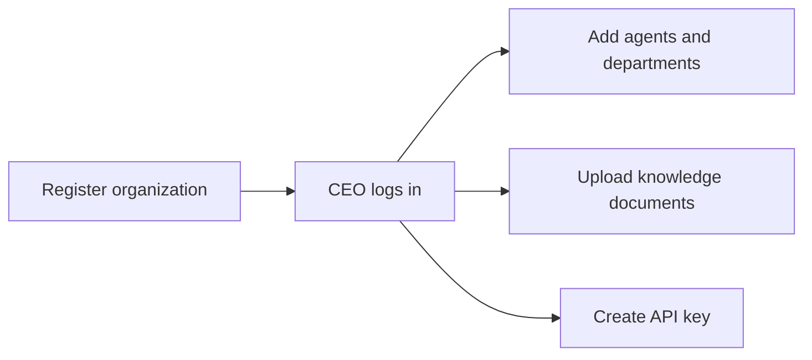
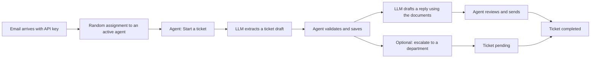

# AI Email Operations

An AI-assisted customer support system for organizations. Incoming emails are assigned to a support agent. A local LLM turns each email into a structured ticket and drafts a reply from the organization's own documents. **A human agent reviews everything before it is saved or sent.**

## What it does

- An organization registers, and its CEO logs in with the organization's email and password.
- The CEO adds and removes support agents (each with their own login) and departments.
- The CEO uploads the organization's knowledge documents (`.txt`, `.pdf`, `.docx`).
- Emails arrive through an API (secured by a per-organization API key) and are randomly assigned to an active agent.
- The agent starts a ticket, reviews the AI's draft, and saves it. The AI drafts a reply using the organization's documents, and the agent reviews and sends it.
- If another department is needed, the agent escalates: the ticket becomes `pending`, then `completed` when handled.

The AI never writes to the database or sends anything without a human check.

## How it works

Setup (once per organization):



Every email:



## Tech stack

| Part | Tool |
|---|---|
| API | FastAPI, Pydantic |
| Database | PostgreSQL 16 with pgvector, SQLAlchemy, Alembic |
| LLM | Ollama (`qwen2.5:7b`), embeddings with `nomic-embed-text` |
| RAG | LlamaIndex, vectors stored in Postgres |
| Documents | pypdf, python-docx |
| Auth | JWT (python-jose), bcrypt (passlib), hashed API keys |
| Cache | Redis |
| Tests | pytest |
| Packaging | uv, Docker Compose |

## Three kinds of credentials

| Who | Credential | Used for |
|---|---|---|
| CEO | Token from `/auth/org-login` (role `org`) | Agents, departments, documents, API key |
| Agent | Token from `/auth/login` (role `agent`) | Their own emails and tickets |
| Email source | `X-API-Key` header | Only `POST /inbound/emails` |

Tokens carry a role, so an agent token can never be used as a CEO token, and the other way around.

## Quick start

You need [Docker Desktop](https://www.docker.com/products/docker-desktop/), [Ollama](https://ollama.com), and optionally [uv](https://docs.astral.sh/uv/) for running tests.

1. Download the models:

```powershell
ollama pull qwen2.5:7b
ollama pull nomic-embed-text
```

2. Create your settings file, then open `.env` and set `SECRET_KEY`:

```powershell
Copy-Item .env.example .env
uv run python -c "import secrets; print(secrets.token_hex(32))"
```

3. Start Postgres, Redis, the migrations and the API:

```powershell
docker compose up -d --build
```

4. Open the interactive docs at http://localhost:8000/docs.

If the API container cannot reach Ollama, set the Windows environment variable `OLLAMA_HOST` to `0.0.0.0` and restart Ollama.

## Walkthrough

Use a normal-looking email domain: addresses such as `@acme.test` are rejected at registration.

```powershell
# 1. Register an organization and log in as the CEO
Invoke-RestMethod -Method Post -Uri http://localhost:8000/orgs/register -ContentType "application/json" -Body '{"name":"Initech","email":"ceo@initech-corp.com","password":"supersecret1"}'
$orgToken = (Invoke-RestMethod -Method Post -Uri http://localhost:8000/auth/org-login -Body @{username="ceo@initech-corp.com"; password="supersecret1"}).access_token

# 2. Add a support agent
Invoke-RestMethod -Method Post -Uri http://localhost:8000/orgs/me/agents -Headers @{Authorization="Bearer $orgToken"} -ContentType "application/json" -Body '{"name":"Ivy","email":"ivy@initech-corp.com","password":"supersecret1"}'

# 3. Upload a knowledge document (sample files are in knowledge/acme)
curl.exe -X POST http://localhost:8000/orgs/me/knowledge -H "Authorization: Bearer $orgToken" -F "file=@knowledge/acme/refund_policy.txt"

# 4. Create an API key and send an email with it
$key = (Invoke-RestMethod -Method Post -Uri http://localhost:8000/orgs/me/api-key -Headers @{Authorization="Bearer $orgToken"}).api_key
$mail = Invoke-RestMethod -Method Post -Uri http://localhost:8000/inbound/emails -Headers @{"X-API-Key"=$key} -ContentType "application/json" -Body '{"sender_email":"customer@example.com","subject":"Charged twice","body":"I was charged twice for my order."}'

# 5. Log in as the agent and ask for a reply draft
$agentToken = (Invoke-RestMethod -Method Post -Uri http://localhost:8000/auth/login -Body @{username="ivy@initech-corp.com"; password="supersecret1"}).access_token
Invoke-RestMethod -Method Post -Uri "http://localhost:8000/emails/$($mail.id)/draft-reply" -Headers @{Authorization="Bearer $agentToken"}
```

## Endpoints

**Public**

| Method | Path | Purpose |
|---|---|---|
| POST | `/orgs/register` | Register an organization |
| POST | `/auth/org-login` | CEO login |
| POST | `/auth/login` | Agent login |
| GET | `/health` | Health check |

**CEO (organization token)**

| Method | Path | Purpose |
|---|---|---|
| GET | `/orgs/me` | Organization profile |
| POST, GET | `/orgs/me/agents` | Add an agent, list agents |
| DELETE | `/orgs/me/agents/{id}` | Deactivate an agent and hand their waiting emails to others |
| POST, GET | `/orgs/me/departments` | Add a department, list departments |
| DELETE | `/orgs/me/departments/{id}` | Remove a department |
| POST, DELETE | `/orgs/me/api-key` | Create or replace the API key, revoke it |
| POST, GET | `/orgs/me/knowledge` | Upload a document, list documents |
| DELETE | `/orgs/me/knowledge/{id}` | Delete a document and its searchable chunks |

**Email source (API key)**

| Method | Path | Purpose |
|---|---|---|
| POST | `/inbound/emails` | Deliver an email, assigned to a random active agent |

**Agent (agent token)**

| Method | Path | Purpose |
|---|---|---|
| GET | `/me/emails` | My emails (`?only_new=true` for emails without a ticket) |
| GET | `/me/tickets` | My tickets (`?status=open`, `pending` or `completed`) |
| POST | `/emails/{id}/start-ticket` | AI ticket draft (cached, `?refresh=true` to redo) |
| POST | `/emails/{id}/ticket` | Save the validated ticket |
| POST | `/emails/{id}/draft-reply` | AI reply draft from the knowledge base |
| POST | `/tickets/{id}/reply` | Send the reviewed reply |
| POST | `/tickets/{id}/escalation-draft` | AI draft for a department |
| POST | `/tickets/{id}/escalate` | Send it, ticket becomes `pending` |
| POST | `/tickets/{id}/complete` | Ticket becomes `completed` |

## Development

Run the API on your machine instead of in Docker (stop the Docker `api` first, because both use port 8000):

```powershell
docker compose stop api
docker compose up -d db redis
uv sync
uv run alembic upgrade head
uv run uvicorn ai_email_ops.app.main:app --reload
```

## Tests

Tests use a separate database and never call the real LLM, the vector store or Redis.

```powershell
docker compose exec db psql -U postgres -c "CREATE DATABASE emailops_test"
uv run pytest -v
```

## Design decisions

- **Human in the loop:** every AI output is reviewed before it is stored or sent.
- **Structured output:** the Pydantic schema is passed to Ollama and validated again. Field meanings are explained in the system prompt, because the schema only guarantees the shape.
- **Tenant isolation:** every document chunk carries an `organization_id`, and one function does all searching with the filter applied. Agents and documents are always looked up through the organization found from the token or key, never from the request body.
- **Roles in tokens:** a token carries its role, and each route family demands the right one.
- **API keys are stored as hashes** and shown once. SHA-256 is enough because the keys are long random values, unlike passwords.
- **Duplicates blocked by the database:** unique constraints, not only code checks, so double clicks cannot create two tickets, replies or documents.
- **Agents are deactivated, not deleted:** history stays intact, their login stops working immediately, and their waiting emails move to other agents in the same commit.
- **Safe uploads:** the file type is checked by extension and content, size and extracted text are capped, and nothing is written to disk.
- **Safe cache:** Redis speeds up ticket drafts, but the app keeps working if Redis is down.

## Known limitations

- Email sending is a stub that only logs (`sender.py`). Real SMTP would replace one function.
- RAG always returns the top 3 chunks, with no minimum similarity score yet.
- No rate limit on `/inbound/emails`, and no email verification when registering an organization.
- Emails that arrive before an organization has any active agent stay unassigned.
- Uploads are processed during the request, so large documents make the request slow. A background job would fix this.
- No OCR: scanned PDFs are refused.
- Agent emails are unique across all organizations, and a removed agent's email stays reserved.
- Ollama runs on the host machine, not in Docker.

## Project layout

```
src/ai_email_ops/app/   FastAPI app: routes, models, AI, RAG, cache, security
migrations/             Alembic migrations
knowledge/              sample company documents to upload
tests/                  pytest tests
```