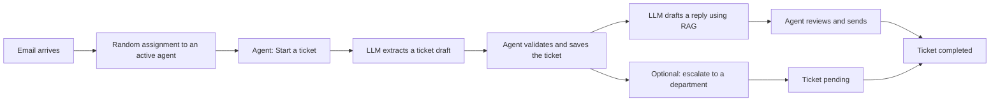

# AI Email Operations

An AI-assisted customer support system. Incoming emails are assigned to a support agent. A local LLM turns each email into a structured ticket and drafts a reply from the company's own documents. **A human agent reviews everything before it is saved or sent.**

## How it works



The AI never writes to the database or sends an email on its own.

## Tech stack

| Part | Tool |
|---|---|
| API | FastAPI, Pydantic |
| Database | PostgreSQL 16 with pgvector, SQLAlchemy, Alembic |
| LLM | Ollama (`qwen2.5:7b`), embeddings with `nomic-embed-text` |
| RAG | LlamaIndex, vectors stored in Postgres |
| Auth | JWT (python-jose), bcrypt (passlib) |
| Cache | Redis |
| Tests | pytest |
| Packaging | uv, Docker Compose |

## Quick start

You need: [Docker Desktop](https://www.docker.com/products/docker-desktop/), [Ollama](https://ollama.com), and [uv](https://docs.astral.sh/uv/).

1. Download the models:

```powershell
ollama pull qwen2.5:7b
ollama pull nomic-embed-text
```

2. Create your settings file, then open `.env` and set `SECRET_KEY`. Generate a key with `uv run python -c "import secrets; print(secrets.token_hex(32))"`:

```powershell
Copy-Item .env.example .env
```

3. Start Postgres, Redis, the migrations and the API:

```powershell
docker compose up -d --build
```

4. Install the Python packages (needed for the helper scripts) and load demo data:

```powershell
uv sync
uv run python scripts/seed.py
uv run python scripts/seed_departments.py
uv run python scripts/ingest_knowledge.py 1 knowledge/acme
```

5. Open the interactive docs at http://localhost:8000/docs.

Demo agents: `asha@acme.test`, `ben@acme.test`, `chen@acme.test`. Password for all: `password123` (**demo data only**).

If the API container cannot reach Ollama, set the Windows environment variable `OLLAMA_HOST` to `0.0.0.0` and restart Ollama.

## Try it

```powershell
$token = (Invoke-RestMethod -Method Post -Uri http://localhost:8000/auth/login -Body @{username="ben@acme.test"; password="password123"}).access_token
Invoke-RestMethod -Uri http://localhost:8000/me/emails -Headers @{Authorization="Bearer $token"}
```

## Main endpoints

| Method | Path | Purpose |
|---|---|---|
| POST | `/auth/login` | Get a token |
| POST | `/emails` | Simulates an incoming email and assigns an agent |
| POST | `/emails/{id}/start-ticket` | AI ticket draft (cached, `?refresh=true` to redo) |
| POST | `/emails/{id}/ticket` | Save the validated ticket |
| POST | `/emails/{id}/draft-reply` | AI reply draft using the knowledge base |
| POST | `/tickets/{id}/reply` | Send the reviewed reply |
| POST | `/tickets/{id}/escalation-draft` | AI draft for a department |
| POST | `/tickets/{id}/escalate` | Send it, ticket becomes `pending` |
| POST | `/tickets/{id}/complete` | Ticket becomes `completed` |
| GET | `/me/emails`, `/me/tickets` | The agent's own inbox |
| GET | `/health` | Health check |

## Tests

Tests use a separate database and never call the real LLM or Redis.

```powershell
docker compose exec db psql -U postgres -c "CREATE DATABASE emailops_test"
uv run pytest -v
```

## Design decisions

- **Human in the loop:** every AI output is reviewed before it is stored or sent.
- **Structured output:** the Pydantic schema is passed to Ollama, then validated again. Field meanings are explained in the system prompt.
- **RAG isolation:** every chunk carries an `organization_id`, and a single function does all searching with the filter applied.
- **Duplicates blocked by the database:** unique constraints, not just code checks, so double clicks cannot create two tickets or two replies.
- **Ownership checks:** agents can only act on their own emails and tickets (403 otherwise).
- **Safe cache:** Redis speeds up ticket drafts, but the app works if Redis is down.

## Known limitations

- Email sending is a stub that only logs (`sender.py`). Real SMTP would replace one function.
- RAG always returns the top 3 chunks, with no minimum similarity score yet.
- Basic auth only: no refresh tokens, roles or rate limiting.
- Ollama runs on the host machine, not in Docker.

## Project layout

```
src/ai_email_ops/app/   FastAPI app (routes, models, AI, RAG, cache)
migrations/             Alembic migrations
scripts/                seed and ingestion scripts
knowledge/              sample company documents
tests/                  pytest tests
```