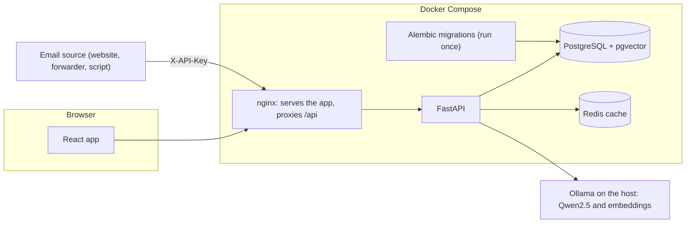

# AI Email Operations

A multi-tenant customer-support system where a **local LLM drafts and a person decides**. Organizations register, set up their team and knowledge base, and receive customer emails through a secured API. Agents turn each email into a ticket and send a reply, using AI drafts that they review and edit first.

Nothing the AI writes is stored or sent without a human check.

## What it does

- **Organizations** register with an email and password. The CEO manages agents, departments, knowledge documents and an API key.
- **Departments have routing rules.** The CEO ticks which categories each department handles (for example Accounting handles billing, Tech handles technical problems).
- **Emails arrive through an API** protected by a per-organization key and are assigned at random to an active agent of that organization.
- **Agents work a ticket in three steps.** The AI drafts a ticket from the email (summary, category, priority, tone). The agent edits and saves it. Then the AI drafts a reply to the customer from the organization's own documents, plus a note for the department that the routing rule suggests, and one click sends both.
- **Knowledge documents** (`.txt`, `.pdf`, `.docx`) are uploaded by the CEO and used by the AI as the source for replies.

<!-- After you record the demo and take screenshots, add them here:
[](PASTE-VIDEO-LINK-HERE)


-->

## How it works

Setup, once per organization: register, add agents and departments (with routing rules), upload documents, create the API key.

Every email:

```mermaid
flowchart LR
    A["Email arrives (API key)"] --> B["Random assignment to an active agent"]
    B --> C["Agent: Start a ticket"]
    C --> D["LLM drafts the ticket"]
    D --> E["Agent edits and saves"]
    E --> F["Rule suggests a department by category"]
    F --> G["LLM drafts the reply (RAG) and the department note"]
    G --> H["Agent reviews and sends both"]
    H --> I["Ticket completed"]
```



A ticket is `open` when saved and `completed` once the emails are sent. The reply, the department notice and the status change are saved in one transaction.

## Architecture



The browser talks to one address. nginx serves the built React app and forwards `/api/...` to FastAPI, so there is no CORS setup in the Docker stack. The model runs on the host machine (it needs the GPU), and the API reaches it through a configurable URL.

## Tech stack

| Part | Tool |
|---|---|
| API | FastAPI, Pydantic, SQLAlchemy, Alembic |
| Database | PostgreSQL 16 with pgvector |
| LLM | Ollama with `qwen2.5:7b` (schema-constrained JSON output) |
| RAG | LlamaIndex, `nomic-embed-text` embeddings stored in Postgres |
| Documents | pypdf, python-docx |
| Auth | JWT with a role claim (python-jose), bcrypt, hashed API keys |
| Cache | Redis |
| Frontend | React, TypeScript, Vite, React Router, TanStack Query, Tailwind CSS |
| Tests and CI | pytest, GitHub Actions |
| Packaging | uv, Docker Compose, nginx |

## Quick start

You need [Docker Desktop](https://www.docker.com/products/docker-desktop/), [Ollama](https://ollama.com), and [uv](https://docs.astral.sh/uv/) (only used to generate a key here).

1. Download the models:

```powershell
ollama pull qwen2.5:7b
ollama pull nomic-embed-text
```

2. Create your settings file, then open `.env` and set `SECRET_KEY` to the output of the second command:

```powershell
Copy-Item .env.example .env
uv run python -c "import secrets; print(secrets.token_hex(32))"
```

3. Start everything (database, cache, migrations, API and the web app):

```powershell
docker compose up -d --build
```

4. Open the app at http://localhost:8080. The API documentation is at http://localhost:8000/docs.

The first AI request is slow, because the model has to load. If the API container cannot reach Ollama, set the Windows environment variable `OLLAMA_HOST` to `0.0.0.0` and restart Ollama.

## Try it

1. Open http://localhost:8080, click **Register**, and create an organization. Use a normal-looking email domain, because reserved ones such as `.test` are rejected.
2. On the CEO pages: add an agent (**Agents**), add departments and tick their categories (**Departments**), upload the sample files from `knowledge/acme/` (**Documents**), and create a key (**API key**).
3. Deliver a customer email the way a website or forwarding service would:

```powershell
$key = "paste-the-key-here"
Invoke-RestMethod -Method Post -Uri http://localhost:8080/api/inbound/emails -Headers @{"X-API-Key"=$key} -ContentType "application/json" -Body '{"sender_email":"anna@example.com","subject":"Charged twice","body":"I was charged twice for order 4821. Please refund the duplicate payment."}'
```

4. Log out, then log in as the agent (the agent login page). Open the email, click **Start a ticket**, edit and save the draft, then use **Draft with AI** for the reply and the department note, and send both.

## Who can do what

| Who | Credential | Can do |
|---|---|---|
| CEO | Token from `/auth/org-login` (role `org`) | Manage agents, departments, documents and the API key |
| Agent | Token from `/auth/login` (role `agent`) | Work their own emails and tickets |
| Email source | `X-API-Key` header | Only deliver emails into its organization |

Tokens carry a role, so an agent token can never act as a CEO token and the other way around.

## API overview

Interactive docs: `/docs`.

**Public**

| Method | Path | Purpose |
|---|---|---|
| POST | `/orgs/register` | Register an organization |
| POST | `/auth/org-login` | CEO login |
| POST | `/auth/login` | Agent login |
| GET | `/health` | Health check |

**CEO (organization token)**

| Method | Path | Purpose |
|---|---|---|
| GET | `/orgs/me` | Organization profile |
| POST, GET | `/orgs/me/agents` | Add an agent, list agents |
| DELETE | `/orgs/me/agents/{id}` | Deactivate an agent and hand their waiting emails to others |
| POST, GET | `/orgs/me/departments` | Add a department (with categories), list departments |
| PUT | `/orgs/me/departments/{id}/categories` | Change which categories a department handles |
| DELETE | `/orgs/me/departments/{id}` | Remove a department |
| POST, DELETE | `/orgs/me/api-key` | Create or replace the API key, revoke it |
| POST, GET | `/orgs/me/knowledge` | Upload a document, list documents |
| DELETE | `/orgs/me/knowledge/{id}` | Delete a document and its searchable chunks |

**Email source (API key)**

| Method | Path | Purpose |
|---|---|---|
| POST | `/inbound/emails` | Deliver an email into the organization |

**Agent (agent token)**

| Method | Path | Purpose |
|---|---|---|
| GET | `/me` | The logged-in agent |
| GET | `/me/emails`, `/me/emails/{id}` | The inbox (`?only_new=true`) and one email |
| GET | `/me/tickets`, `/me/tickets/{id}` | Ticket history (`?status=`) and one ticket with its emails |
| GET | `/me/departments` | Departments of the agent's organization |
| POST | `/emails/{id}/start-ticket` | AI ticket draft (cached, `?refresh=true` to redo) |
| POST | `/emails/{id}/ticket` | Save the reviewed ticket |
| POST | `/emails/{id}/draft-reply` | AI reply draft from the knowledge base |
| POST | `/tickets/{id}/escalation-draft` | AI note for a department |
| POST | `/tickets/{id}/send` | Send the reply and, optionally, the department note, then complete the ticket |

The older `/tickets/{id}/reply`, `/escalate` and `/complete` routes are marked deprecated.

## Development

Run the API and the web app on your machine instead of in Docker (stop the containers that use the same ports first):

```powershell
docker compose stop api web
docker compose up -d db redis
uv sync
uv run alembic upgrade head
uv run uvicorn ai_email_ops.app.main:app --reload
```

In a second window, the web app with live reload:

```powershell
cd frontend
npm install
npm run dev
```

It opens at http://localhost:5173 and talks to the API at http://localhost:8000.

## Tests and CI

Backend tests use a separate database and never call the real LLM, the vector store or Redis:

```powershell
docker compose exec db psql -U postgres -c "CREATE DATABASE emailops_test"
uv run pytest -v
```

Frontend checks: `npm run lint` and `npm run build` (in `frontend`).

GitHub Actions runs four jobs on every push and pull request:

- **Backend tests**, against a real PostgreSQL.
- **Migrations**: builds an empty database from the migrations alone, checks that there is a single head and no drift between models and migrations, and tests downgrade and upgrade.
- **Frontend**: install, lint and build.
- **Docker**: builds the whole stack, starts it, and checks `/api/health` through nginx.

## Design decisions

- **Human in the loop.** Every AI output is an editable draft. Only reviewed data is saved or sent.
- **Structured output.** The ticket schema is passed to the model and validated again by the server. Rules and examples go in the prompt, because the schema only guarantees the shape.
- **Rules for decisions, AI for understanding.** The model picks the category. A plain, configurable rule maps the category to a department.
- **Tenant isolation.** The organization always comes from the token or the API key, never from the request body. Every vector chunk carries an `organization_id`, and one function does all searches with that filter. Another tenant's records look like missing ones (404).
- **API keys are stored as hashes** and shown once. SHA-256 is enough because the keys are long random values, unlike passwords.
- **The database enforces the invariants.** Unique constraints stop duplicate tickets, replies and documents, even with double clicks.
- **One transaction for sending.** The reply, the department note and the status change are committed together before anything is sent.
- **Agents are deactivated, not deleted.** History stays intact, their login stops at once, and their waiting emails move to other agents in the same commit.
- **Safe uploads.** File type is checked by extension and content, size and extracted text are capped, and nothing is written to disk.
- **The cache is optional.** Redis speeds up ticket drafts with a versioned key and a time limit, and the app works without it.
- **AI failures are handled.** A crashed or unreachable model server becomes a clear 503 message, not a generic error.

## Known limitations

- Sending email is a stub that logs the message (`sender.py`). Real SMTP or a provider API would replace one function.
- No rate limiting, and no email verification when registering an organization.
- RAG always returns the top 3 chunks, with no minimum similarity score.
- Uploaded documents are processed during the request, so large files make it slow. No OCR: scanned PDFs are refused.
- Emails that arrive before an organization has an active agent stay unassigned.
- The login token is kept in `localStorage`. An httpOnly cookie would be stronger.
- Agent emails are unique across all organizations, and a removed agent's email stays reserved.
- Ollama runs on the host and is not part of the Compose stack.

## Roadmap

- **Email connectors** in front of the existing ingestion function: Gmail and Microsoft Graph through OAuth (polling or push, de-duplicated on the provider's message id), and signed webhooks from inbound-email services.
- Real outgoing mail through the same provider, keeping replies in the thread.
- Rate limits, a background job for document indexing, and a similarity cutoff for retrieval.
- An evaluation set of labelled emails to measure how often the AI draft is correct and how often agents change it.

## Project layout

```
src/ai_email_ops/app/   FastAPI app: routes, models, AI, RAG, cache, security
migrations/             Alembic migrations
frontend/               React app, Dockerfile and nginx config
knowledge/              sample company documents to upload
tests/                  pytest tests
.github/workflows/      CI
```